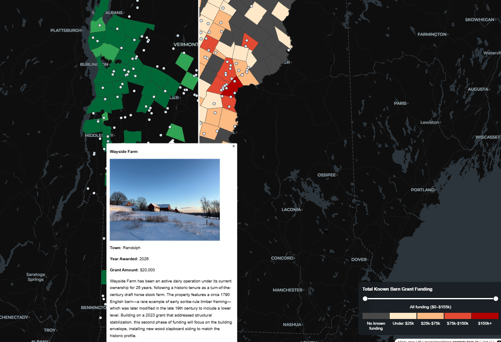
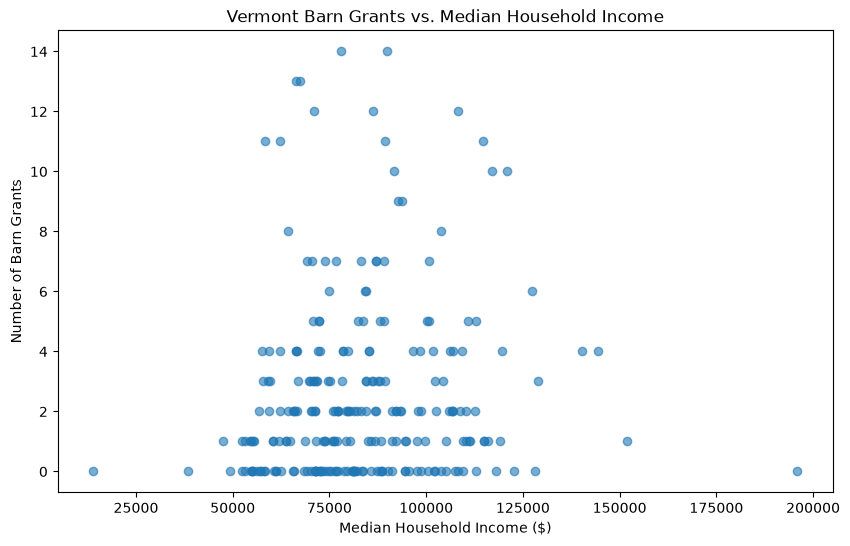

## Vermont Historic Barn Grants

An interactive geospatial analysis exploring the geographic distribution of Vermont's historic barn preservation grants and their relationship with household income.

  <a href="https://georgew330.github.io/vermont-barn-grants/web/">
    <strong>Link -> Vermont Historic Barn Grants Web Map</strong>
  </a>

  

## Research Question

Is there a relationship between a Vermont community's household income and the amount of historic barn preservation grant funding it has received?

## Data Sources & Limitations

### 1. U.S. Census Bureau: American Community Survey (ACS)

Median household income estimates were obtained from the American Community Survey (ACS) and joined to Vermont town boundaries derived from the U.S. Census Bureau's TIGER/Line geographic data.

Of the 256 towns in the geographic dataset, 247 were successfully matched with income estimates. The remaining nine towns have missing income values and were excluded from income based statistical analyses. I used median income because it is less affected by a skew in the data. Since median represents the literal middle of the dataset distribution that says half of households earn more and half earn less. 

### 2. Vermont Historic Barn Preservation Grants: Historical Funding Records (1992–2026)

A historical spreadsheet containing 619 grant records was obtained directly from the Vermont Agency of Commerce and Community Development.

I cleaned and aggregated the records by town to calculate two metrics:

- **Grant count:** The number of recorded grants awarded to each town.
- **Total awarded:** The sum of known grant award amounts for each town.

Some data quality challenges included inconsistent town names, incomplete geographic information, approximately 89 missing award amounts, and the absence of coordinates for older projects.

If a record was missing its award amount, it was excluded from funding sums; however, the corresponding record could still contribute to grant counts.

Therfore, total funding values represent **known awarded amounts**, rather than necessarily complete historical funding totals.

### 3. Vermont ACCD Open Data: Geocoded Barn Grant Locations (2015-2026)

I retrieved a spatial dataset containing 242 geocoded barn grant records from Vermont's Agency of Commerce and Community Development (ACCD) ArcGIS REST service.

Records included geographic coordinates, building names, award years, funding amounts, and project descriptions.

I used the dataset for interactive barn record mapping but since it only went back to 2015 and the program was concieved in 1992 the data does not represent the complete historical grant program.

**Important methodological distinction:** Town level grant counts and amounts used the historical spreadsheet. Individual barn locations were mapped using the geocoded dataset (2015-2026). Using both datasets allowed the analysis to account for older grants that lacked geographic coordinates.

## Key Learning Moments & Technical Takeaways

### Data Acquisition, Cleaning & Integration

Retrieved geospatial data through ArcGIS REST APIs and worked directly with Vermont's historic preservation program to obtain historical grant records unavailable through public GIS service providers or online resources.

Addressed data inconsistencies such as town names, missing values, and differences in geographic coverage. Used data cleaning, aggregation, and joins to integrate historical funding records with Census income estimates and town boundaries.

### Exploratory Data Analysis & Statistical Reasoning

I applied descriptive statistics, percentiles, quantiles, scatterplots, and Pearson's correlation coefficient to investigate relationships between community income and historic preservation grants.

Calculated two Pearson correlation coefficients:

| Variables | Pearson's r |
|---|---|
| Median household income vs. grant count | 0.095006 |
| Median household income vs. total known funding awarded | 0.112461 |

Both results suggest very weak positive linear relationships in the analyzed data. So based on this evaluation we can say there isn't any evidence to suggest that towns with higher average incomes recieve more grants or special treatment when it comes to historic preservation. Nice Vermont!

### Python & Geospatial Analysis

I strengthened my understanding of Python, Pandas, GeoPandas, DataFrames, Series, indexing, and geospatial processing through data exploration and transformation.

### Cartographic Design & Interactive Mapping

I explored choropleth classification methods, color schemes, legends, and how cartographic decisions influence the interpretation of geographic patterns.

I developed an interactive mapping application using MapLibre GL JS, featuring 2 synchronized maps, a draggable comparison divider, and interactive feature popups. I also rebuilt the URL for image retreival into my geodataframe so those sweet barns could display on the screen.

### Web Development & Software Workflows

I gained some good experience with HTML, CSS, and JavaScript.

Used Git, GitHub, VS Code, and Jupyter notebooks to organize and document the project.

### Vector Tiles, Local Servers & Troubleshooting

Used Windows Subsystem for Linux (WSL) with Ubuntu to install and run Tippecanoe, generating a PMTiles archive containing Vermont town polygons and geocoded barn locations.

Some technical challenges I encountered during the transition from GeoJSON to vector tiles below:

- **HTTP byte-range requests:** Python's basic HTTP server returned `200 OK` when requesting portions of the PMTiles archive. Switching to Node.js `http-server` enabled `206 Partial Content` responses, allowing the application to retrieve the required byte ranges.
- **Point visibility at lower zoom levels:** Tippecanoe has this feature dropping behavior which initially caused almost all my barn locations to disappear at the landing page statewide zoom level. You had to zoom reaaallly close to render them - NOT ideal. I regenerated the PMTiles archive using the `-r1` option to adjust feature dropping behavior so all points load at the desired zoom level.
- **Browser caching:** After replacing the PMTiles archive, the browser continued using previously cached content. Appending a version query parameter (`?v=2`) to the resource URL forced the browser to request the updated archive, a technique known as cache busting. I've never done this before and didn't even know it was a thing, happy to have learned that and won't forget it.

**TLDR:** These challenges helped me understand how vector tile generation, HTTP requests, and browser caching affect the performance and reliability of web mapping applications.

### AI-Assisted Development

I used AI to help draft code, explain things I didn't understand, debug problems, and evaluating implementation decisions I came up with. I never had AI "just do this for me". I used it as a teacher in conjunction with various other sources to round out the echo chamber (i.e. Documentation, Stack, even Youtube).

This approach allows me to work with unfamiliar technologies, sharpen my skills, learn new concepts/languages/processes, and produce work I otherwise wouldn't have been able to in the same timeframe.

## Overall Takeaway

This project was honestly really fun and interesting. I had to flex my mathematics muscles, sit through painstaking data wrangling/cleaning, work with various data sources (ESRI REST/Cencus Data/3rd Party Sources), learn how JavaScript works inside an HTML file, fiddle with CSS, MapLibre'd, did more writing than I thought I'd be doing, and cartographic design, web design and functionality. It took me about 2 months! There was no desktop GIS going on, only open source geospatial application development - pretty stoked on that.

While I am still developing fluency with several of the technologies used, I learned how to identify appropriate tools, integrate them into a functional workflow, troubleshoot implementation challenges, and deliver a complete geospatial application. By using PMTiles and GitHub Pages, I'm able to make the application publicly accessible with no hosting cost, no database, backend server, or external data API. Pretty sweet.
